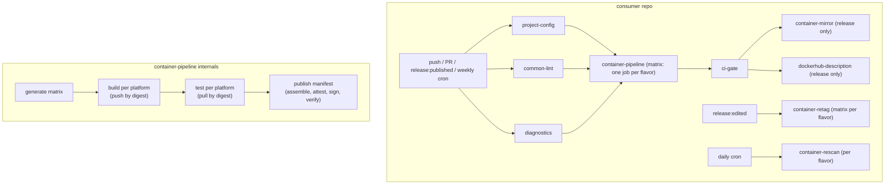

# v5 Modernization — Plan #

Stage 2 of 3. This document turns the requirements in
[requirements.md](requirements.md) into a concrete design and a phased
delivery plan. Stage 3 decomposes the phases into ordered tasks.

## Decisions carried into this plan ##

Resolved from the stage-1 open questions:

1. **Base images: canonical docker.io references with
   `mirror.gcr.io` as a BuildKit registry mirror.** No AWS account is
   available and no GitHub-hosted mirror of Docker official images
   exists. Testing (2026-10-19) showed `mirror.gcr.io` serves
   arbitrary public Docker Hub images on demand — including
   low-traffic user namespaces — with digests identical to Docker
   Hub, and Google documents that pulls from it "do not count against
   Docker Hub rate limits." Google also states cache presence is not
   guaranteed and that the mirror should be consumed via Docker/
   BuildKit mirror configuration (which falls back to Docker Hub on a
   miss), never via direct `FROM mirror.gcr.io/...` references. v5
   configures the mirror centrally in the build workflow; an
   own-namespace GHCR sync remains the documented contingency.
1. **Schedules:** daily SBOM rescan; full rebuild (refreshing `edge`)
   weekly.
1. **Signing:** keep cosign keyless signatures alongside GitHub
   artifact attestations.
1. **Releases:** automate with release-please (conventional commits are
   already in use here), publish immutable releases, keep floating
   major tags as plain git tags.
1. **Flavor API:** single-flavor pipeline workflow + caller-side
   matrix (rationale below).
1. **GHCR is the system of record (2026-10-19).** Docker Hub
   publication (mirror + README) continues in maintenance mode but may
   be dropped in v5; Docker Hub-specific hardening (immutable tags) is
   de-scoped. All attestation, signing, verification, and rescan work
   targets ghcr.io.

## Target architecture ##



### Workflow inventory ###

| Workflow | v4 | v5 |
| --- | --- | --- |
| `container-pipeline.yml` | — | New: build→test→publish for one flavor |
| `container-rescan.yml` | — | New: scheduled SBOM-based CVE rescan |
| `container-retag.yml` | — | New: floating-tag reconciliation |
| `project-config.yml` | — | New: version/image/platform derivation |
| `ci-gate.yml` | — | New: aggregate status for protection |
| `container-build.yml` | Reusable | Kept; fork-PR aware; attest@v4 |
| `container-test.yml` | Reusable | Kept; minor dedupe |
| `container-publish-manifest.yml` | Reusable | Kept; tag guard; index SBOM; verify gate |
| `container-mirror.yml` | snake_case | Kept; kebab-case; immutable-tag tolerant |
| `dockerhub-description.yml` | snake_case | Kept; kebab-case |
| `common-lint.yml` | Reusable | Kept; adds actionlint + zizmor |
| `container-metadata.yml` | Reusable workflow | Composite action |
| `container-sign.yml` | Dead code | Removed (signing stays in publish) |

New composite actions (`.github/actions/`): `container-metadata`
(tags/labels/annotations/version/commit-epoch), `platform-matrix`
(platform→runner mapping shared by build and test), and
`python-test-deps` (uv/pip detection shared by test and lint).
Converting metadata to a composite removes two jobs per flavor, folds
in the `calculate-source-date-epoch` and `determine-visibility` jobs,
and frees a workflow-nesting level (GitHub allows four levels; the v5
chain is consumer → pipeline → build, leaving headroom).

## Design ##

### D1 — Base-image pulls through mirror.gcr.io (R1) ###

- `FROM` lines move from `public.ecr.aws/docker/library/` to the
  canonical docker.io references (`rust:trixie`, `node:<ver>-slim`).
  Dependabot tracks these natively.
- `container-build.yml` configures BuildKit (via `setup-buildx-action`
  inline buildkitd config) to route docker.io pulls through the
  mirror:

```toml
[registry."docker.io"]
  mirrors = ["mirror.gcr.io"]
```

- Mirror pulls do not count against Docker Hub rate limits; on a
  cache miss BuildKit falls back to Docker Hub automatically — the
  consumption model Google documents. The runner's Docker daemon gets
  the matching `registry-mirrors` setting so daemon-side pulls
  (QEMU/binfmt setup, `moby/buildkit` driver, `tonistiigi/xx`) are
  covered too — closing the issue #428 exposure.
- Fallback hardening: optional Docker Hub credentials (the same
  secrets already used for release mirroring) authenticate the
  fallback path, plus retry/backoff for transient 429/5xx.
- Contingency (documented, not built): if mirror behavior regresses,
  a scheduled `base-image-sync.yml` copies bases digest-preserved to
  `ghcr.io/<owner>/mirror/<name>` and `FROM` lines point at the
  copies. No API change required to adopt it later.

### D2 — Flavors via pipeline + caller matrix (R4.3) ###

`container-pipeline.yml` runs the full chain for **one** flavor.
Callers express flavors as a matrix over the pipeline job:

```yaml
jobs:
  pipeline:
    strategy:
      fail-fast: false
      matrix:
        include:
          - flavor: public
            image-name: felddy/foundryvtt
            platforms: '["linux/amd64","linux/arm64", ...]'
            scan-severity: CRITICAL,HIGH
          - flavor: private
            image-name: felddy/foundryvtt-preinstall
            platforms: '["linux/amd64"]'
            scan-severity: ""
            upload-scan-results: false
            private: true
            pass-build-secrets: true
    uses: felddy/reusable-workflows/.github/workflows/container-pipeline.yml@v5
    with:
      image-name: ${{ matrix.image-name }}
      platforms: ${{ matrix.platforms }}
      private: ${{ matrix.private || false }}
      # ...
    secrets: inherit
```

Why this shape instead of a flavors-JSON input processed internally:
secrets stay static (no dynamic `secrets[...]` indexing), per-flavor
configuration is visible in the caller, the Actions UI shows one named
pipeline per flavor, and failures isolate cleanly. The pipeline uses
its `private` / `pass-build-secrets` inputs to decide which inherited
secrets to forward, so the public flavor never sees the private token
or build secrets. foundryvtt-docker's six copy-pasted jobs collapse to
one matrixed job plus the gate; this repo's `_build.yml` dogfoods the
same pattern with its public + `-hid` flavors.

Pipeline inputs consolidate today's build/test/publish inputs plus:
`test-platforms`, `cache-scope` (defaults to the flavor name),
`vex-file`, `force-tag-overwrite`. Mirror/readme jobs stay caller-side
(per-repo policy), as does `container-rescan` scheduling.

### D3 — Fork-PR handling inside the build (R4.2) ###

`container-build.yml` detects fork PRs itself
(`github.event.pull_request.head.repo.full_name != github.repository`)
and downgrades to build-only mode: build each platform without
pushing, skip digest export, scans, attestations. The pipeline then
skips test/publish stages. Fork contributors get real per-platform
build feedback (today the jobs are skipped entirely); callers drop all
fork conditionals.

### D4 — Immutability (R2) ###

- **Tag classes.** Semver tags (default pattern
  `^v?[0-9]+\.[0-9]+\.[0-9]+([-+].*)?$`) are immutable-class; `latest`,
  `release`, `edge`, `MAJOR`, `MAJOR.MINOR`, `pr-*`, branch and `sha-*`
  tags are floating. Before manifest push, publish resolves each
  immutable-class tag with crane: exists with same digest → no-op;
  exists with different digest → fail unless `force-tag-overwrite`.
- **Triggers.** `release: published` runs the full pipeline.
  `release: edited` no longer rebuilds; it runs `container-retag.yml`,
  which recomputes desired floating tags from release state (notes,
  prerelease flag, and latest marker remain editable under
  immutability) and repoints `latest`/`release`/`MAJOR`/`MAJOR.MINOR`
  at the semver tag's existing digest, then re-runs mirror/readme.
  This also finally gives "promote an older release to latest" a
  correct, build-free path.
- **Digest-on-release.** After a release-event publish, the pipeline
  writes an idempotent "Container images" section (tag → index digest
  → verify commands) into the release notes between HTML marker
  comments via the API (notes stay editable post-publish; assets do
  not). Requires `contents: write` on the publish job.
- **Docker Hub.** De-scoped (GHCR is the system of record; Docker Hub
  publication is maintenance-only pending possible removal in v5).
  `container-mirror.yml` still gains tolerance for rejected pushes
  whose digests already match, so enabling Hub immutable tags later
  cannot break the mirror.
- **This repo.** Enable release immutability; releases are published
  complete by release-please (D7). Floating `v5` is a plain git tag
  moved by a small post-release job (plain tags are not locked).

### D5 — Attestations, SBOM, scanning (R3) ###

- **actions/attest@v4 everywhere** (provenance mode, SBOM mode via
  `predicate-path`, and the cosign vuln predicate as a custom
  predicate), replacing `attest-sbom`/`attest-build-provenance`
  wrappers. Jobs add the `artifact-metadata: write` permission
  (breaking for callers with explicit permission blocks — in the
  migration guide).
- **Index-level subjects.** Publish downloads the per-platform SBOM
  artifacts and attests each against the index digest (predicate-type
  SPDX), in addition to the existing per-platform attestations and the
  index provenance. Result: `gh attestation verify
  oci://ghcr.io/<image>:<tag>` finds provenance and SBOMs.
- **Verification gate.** Publish ends with a gate step: `gh
  attestation verify` (provenance + SBOM predicate types) and `cosign
  verify` against the pushed tag must pass or the pipeline fails.
- **Rescan.** `container-rescan.yml` inputs: `image-name`, `tags`
  (JSON, default `["latest"]`), `scan-severity`, optional private
  token. For each tag: resolve index → platform digests, fetch the
  attested SBOMs, `trivy sbom` against each (no image pull, no
  rebuild), upload SARIF (category `rescan-<platform>`), refresh the
  vuln attestation, and fail the run when findings exceed the
  threshold (red scheduled run = the alert). This repo and consumers
  schedule it daily; `_build.yml`'s cron becomes weekly (refreshes
  `edge`).
- **VEX.** `vex-file` input threads OpenVEX into Trivy (`--vex`) in
  both build-time scans and rescans.
- **Trivy resilience.** Set `TRIVY_DB_REPOSITORY` /
  `TRIVY_JAVA_DB_REPOSITORY` to a comma-separated fallback list
  (ghcr.io primary, mirror.gcr.io and public.ecr.aws fallbacks).
- **Deferred (could):** BuildKit-native `sbom: true` /
  `provenance: mode=max` emission; dependency submission API upload.
  Both are additive and can follow v5.0.0.
- **Docs.** State the SLSA v1.0 Build L3 posture and exact consumer
  verification commands in the README.

### D6 — Config, gate, naming, dedupe (R4) ###

- `project-config.yml`: inputs `version-file` (default `version.txt`),
  `image-name` (default `ghcr-owner/repo`), `platforms`,
  `test-platforms`; outputs those plus `version` and derived
  `build-args` lines (`CONTAINER_VERSION=…`). Covers both consumer
  repos' `make github-output` duplication; repos with bespoke
  derivations (foundry's `major.build`) override via one small step.
- `ci-gate.yml`: caller passes `${{ toJSON(needs) }}`; the gate passes
  when every result is `success` or `skipped`. One branch-protection
  check per repo.
- **Naming:** every input/secret/output becomes kebab-case
  (`container-mirror.yml`, `dockerhub-description.yml` break). One
  auth story: `private-package-token` (+ `-username`) is the only
  private-auth secret name across build, test, publish, rescan,
  retag; `registry-token` is removed.
- **Dedupe:** shared composites (metadata, platform-matrix, python
  deps); SOURCE_DATE_EPOCH comes from the metadata composite's
  `commit-epoch` output; numbered `build/test-secret-1..5` interface
  stays (workflow_call cannot express maps) but the internal plumbing
  collapses to a loop.

### D7 — Release automation for this repo (R2.6, R5.4) ###

- release-please (manifest mode): maintains a release PR from
  conventional commits, bumps `version.txt` (extra-files), writes the
  changelog, and publishes the GitHub release on merge — complete at
  publish, as immutable releases require.
- Post-release job moves the floating `v5` major tag to the release
  commit.
- `bump-version` is retired here; `version.txt` can no longer drift
  from tags.

### D8 — Rulesets as code (R5.6) ###

Port foundryvtt-docker's mechanism: each `.github/rulesets/*.json` is
one self-contained ruleset addressed by its `name`;
`make apply-ruleset` creates-or-updates each via `gh api`, and
`make export-ruleset` round-trips UI edits back into the files. This
repo gains a small Makefile carrying just those targets. Applying
requires admin-authenticated `gh`, so it remains a local operator
tool (Actions' `GITHUB_TOKEN` cannot hold repository-administration
permission).

This repo's rulesets, shaped for the v5 design:

- `development.json` — develop-branch protections; the required
  status check becomes the v5 `ci-gate`, so that rename ships as a
  reviewable ruleset diff alongside the workflow change.
- `version-tag.json` — locks full semver tags (`v*.*.*` patterns):
  creation, update, and deletion blocked except for bypass actors.
  This complements immutable releases (which lock a tag only once its
  release is published) and the publish-time overwrite guard.
- Floating major tags (`v4`, `v5`) must keep advancing, so they are
  excluded from the semver lock and covered by an advance-only
  ruleset (deletion and non-fast-forward blocked, updates allowed).
  Whether GitHub evaluates a forward tag move as fast-forward needs
  verification during implementation; the fallback is a bypass entry
  for the workflow identity that moves the tag.
- Release automation (D7) creates the semver tag, so the tag ruleset
  needs a bypass actor for the identity release-please runs as.

### D9 — Hygiene (R5) ###

- dependabot.yml: drop `npm` and `docker-compose` ecosystems.
- Fix the automerge-label defect (#485).
- Add `actionlint` and `zizmor` pre-commit hooks (runs in this repo
  and in every consumer via `common-lint.yml`).
- Fix the corrupted action-version comment in the metadata source.

## Delivery phases ##

Phases A and B are non-breaking and ship as v4.x releases, fixing the
daily failures immediately; the breaking surface ships together in v5.

### Phase A — stop the bleeding (v4.3.x) ###

1. Switch this repo's base images to canonical docker.io references
   and add the mirror.gcr.io BuildKit + daemon mirror configuration
   to `container-build.yml`; optional authenticated Docker Hub
   fallback; pull retries.
1. Trivy DB fallback repositories.
1. Port rulesets-as-code from foundryvtt-docker (`.github/rulesets/`
   and Makefile apply/export targets) with the v4-era required
   checks; D8's v5 shape follows in Phase C.
1. Hygiene: dependabot ecosystems, #485, comment fix, actionlint +
   zizmor hooks.

Exit: one week of green scheduled builds with no registry 429s;
`docker buildx` logs show base images resolving via the mirror.

### Phase B — attestation modernization (v4.4.x) ###

1. Migrate to `actions/attest@v4` (closes #488) — additive permission
   documented; existing callers unaffected if using default
   permissions.
1. Index-level SBOM attestations + post-publish verification gate.
1. `container-rescan.yml` + daily schedule here; weekly `_build` cron.

Exit: `gh attestation verify oci://…:latest` passes for provenance and
SBOM; daily rescan green and demonstrably not pulling base images.

### Phase C — v5 breaking core (v5.0.0-rc) ###

1. Metadata/platform-matrix/python-deps composites; delete
   `container-sign.yml`; internal dedupe.
1. `container-pipeline.yml`, `project-config.yml`, `ci-gate.yml`;
   fork-PR internal handling; kebab-case + token unification.
1. Immutability set: tag-overwrite guard, `release: edited` →
   `container-retag.yml`, digest-on-release notes, mirror
   immutable-tag tolerance.
1. Rewrite `_build.yml` on the v5 pattern (dogfood: two flavors, gate,
   retag path); README + migration guide.

Exit: this repo runs wholly on v5-rc; migration guide complete.

### Phase D — release & migrate (v5.0.0) ###

1. release-please + floating-major-tag job; enable release
   immutability on this repo; cut v5.0.0 as an immutable release.
1. Migrate foundryvtt-docker (flavor matrix, docker.io node base via
   the mirror, rescan schedule, Docker Hub immutable tags) and
   weewx-docker; enable release immutability there.

Exit: both consumers green on v5; v4 branch left in maintenance.

## Risks and mitigations ##

- **`mirror.gcr.io` has no SLA** and Google guarantees neither cache
  presence nor retention. Mitigation: it is consumed strictly as a
  mirror with automatic Docker Hub fallback (optionally
  authenticated); digests are upstream-identical by construction. If
  it regresses structurally, the D1 contingency (own-namespace GHCR
  sync) restores control without any API change.
- **Matrixed `uses:` jobs + `secrets: inherit`** pass all secrets to
  all flavors; the pipeline must gate forwarding on the `private` /
  `pass-build-secrets` inputs. Covered by dogfood (public flavor build
  must show zero secret mounts).
- **`actions/attest@v4` permission addition** silently fails for
  callers with explicit permission blocks. Mitigation: fail fast with
  a clear error when `attestations`/`artifact-metadata` permissions
  are missing; prominent migration-guide entry.
- **release-please on a non-conventional commit** mislabels a version.
  Mitigation: PR title lint already enforced by convention; the
  release PR is human-approved before publish.
- **Nesting/limits:** v5 keeps the reusable-workflow chain at three
  levels and well under the 20-unique-workflow cap.

## Stage 3 ##

Tasks will decompose each phase into PR-sized units with acceptance
criteria, ordered so every merge keeps `develop` releasable, and
including the consumer-repo migration checklists.
